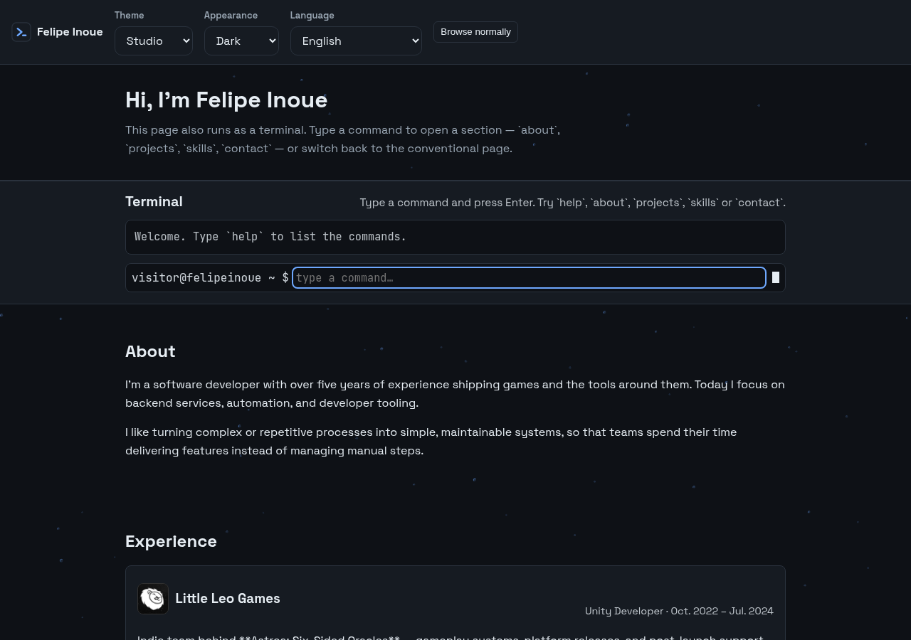
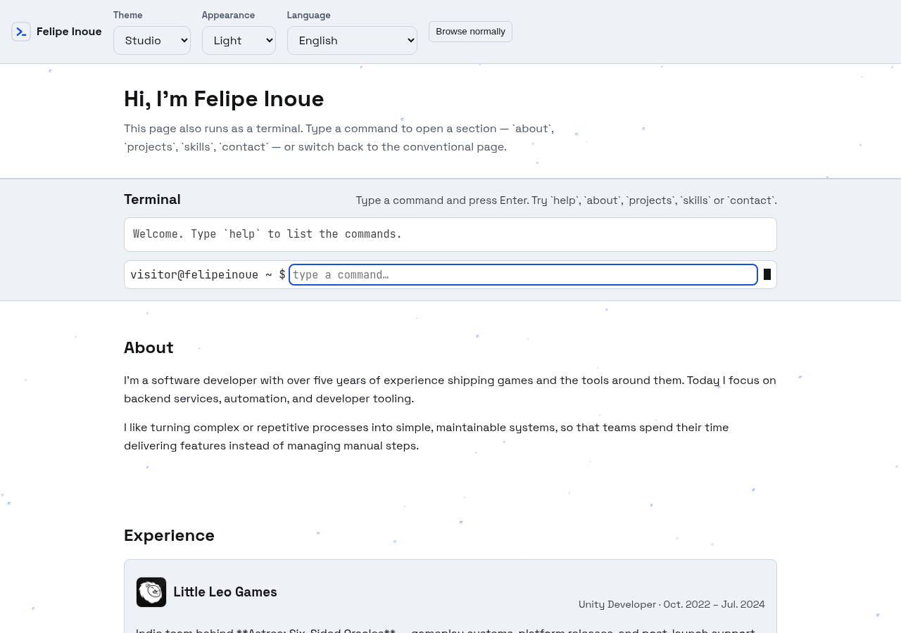
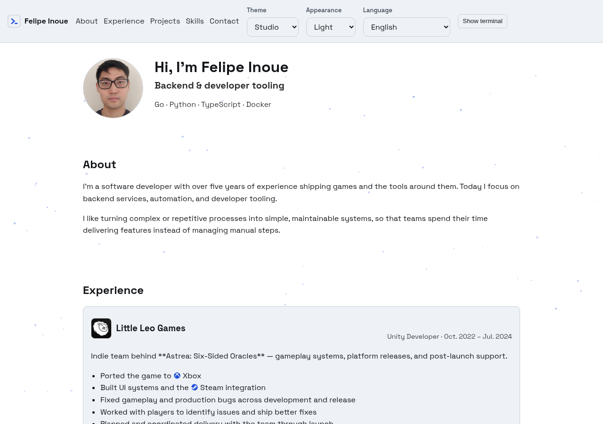
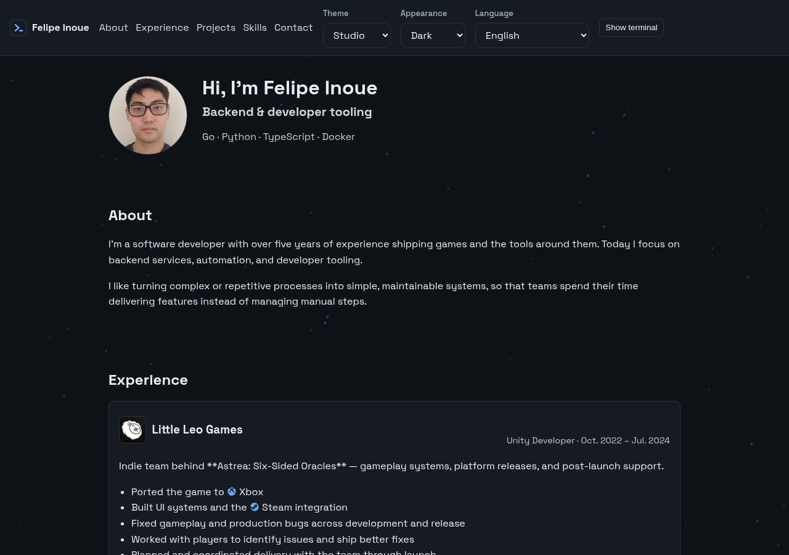

# felipeinoue.com

Personal portfolio of **Felipe Inoue** — a single-page static site built with
**React + TypeScript + Vite**, deployed to GitHub Pages at
<https://felipeinoue.com/>.



## What it is

A one-page site for a backend and tooling developer. Every section is always
rendered, and a **terminal** is docked beside the page: a real command line
(`about`, `projects`, `skills`, …) that scrolls the page to the section a command
names. The console is optional — a header toggle collapses it for visitors who
would rather just read.

One page, English and Brazilian Portuguese, three colour presets in light, dark,
or the system's choice, and a background of slow particles.

## Features

- **Terminal-docked navigation** — a pure parser/history layer with EN/PT-BR
  command aliases (`help`, `clear`, `about`, `projects`, `work`, …) whose
  navigation commands scroll the page.
- **One page, optional console** — every section always renders; the terminal
  dock is toggled per visitor and remembered.
- **Three theme presets** (Studio, Paper, Terminal) × light/dark/system, applied
  before first paint so there is no flash of the wrong palette.
- **Bilingual** — EN and PT-BR, with the document language kept in sync.
- **Repository cards** — language, stars and last-push date, read from a
  build-time snapshot (`npm run stats`), never from the browser.
- **Accessible** — skip link, WCAG AA contrast enforced in tests, keyboard-operable
  terminal, gallery, image viewer and back-to-top.
- **Reduced-motion aware** — the particle layer and scroll reveals stand down.

## Screenshots

### Terminal dock open

| Light                                                             | Dark                                                            |
| ----------------------------------------------------------------- | --------------------------------------------------------------- |
|  |  |

### Console collapsed

| Light                                                               | Dark                                                              |
| ------------------------------------------------------------------- | ----------------------------------------------------------------- |
|  |  |

Regenerate these with `make screenshots` — see
[`docs/screenshots/README.md`](docs/screenshots/README.md).

## Development

```bash
npm install          # install dependencies
npm run dev          # start the dev server
make check           # sandbox config, project docs, format-check, lint, type-check, test, build
npm run stats        # refresh the repository cards from the GitHub API (needs `gh`)
make screenshots     # rebuild + capture the README images (needs Chrome)
python3 scripts/fetch-fonts.py   # refresh the self-hosted webfonts
```

This repository previously held a Hugo site. The Hugo sources are preserved at
the tag `archive/hugo`.

## Dev sandbox

Docker is optional — `make dev` needs nothing but Node. To work inside a
container instead (a machine with no Node, or to keep the host clean):

```bash
make setup-host     # one-time host bootstrap (mise, gh login, config dirs)
make dev-up         # build + start; Vite on http://localhost:5173
make dev-log        # follow the container output
make opencode       # run opencode inside the sandbox
make dev-shell      # interactive shell in the sandbox
make dev-down       # stop it
```

The source is bind-mounted, the GitHub token is forwarded at runtime (never baked
into the image), and `gh`/`opencode`/git config are mounted read-only. See
`AGENTS.md` → "Dev sandbox" for the details, including why `opencode` must be
upgraded on the host (`make opencode-upgrade`).

## Assets

- `public/avatar/felipeinoue-512.jpg` — the hero portrait, downloaded from the
  GitHub profile. Re-download it when the profile photo changes:
  `curl -fsSL "https://github.com/fiwon123.png?size=512" -o public/avatar/felipeinoue-512.jpg`
- `public/fonts/` — self-hosted Space Grotesk and JetBrains Mono (SIL OFL 1.1);
  see `public/fonts/README.md`.
- `src/assets/icons/` — brand marks, painted with a CSS mask so they take the
  active theme colour.
- `docs/screenshots/` — the images above; see
  [`docs/screenshots/README.md`](docs/screenshots/README.md) to regenerate them.

## Documentation

Project conventions, the branching model, the CI strategy, and the development
workflow live in [`AGENTS.md`](./AGENTS.md).

## License

All rights reserved. The source is public for reference; no license is granted
for reuse.
